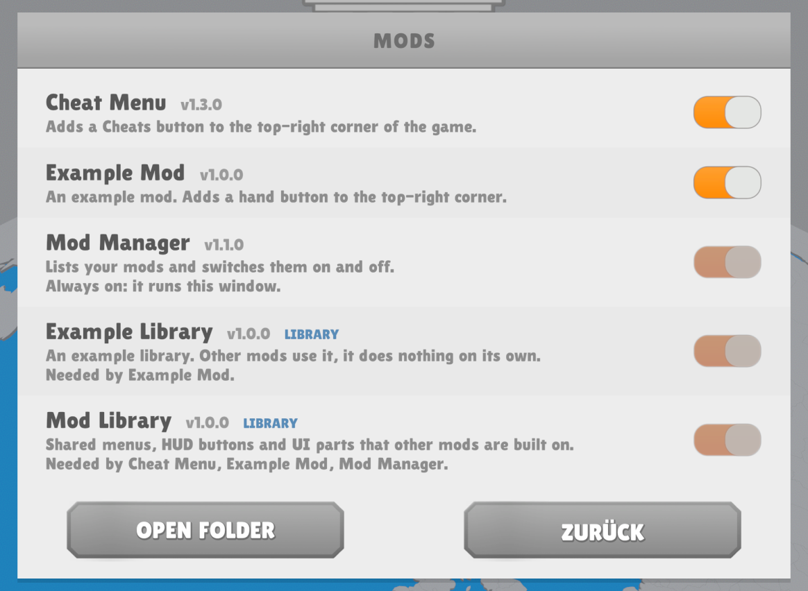
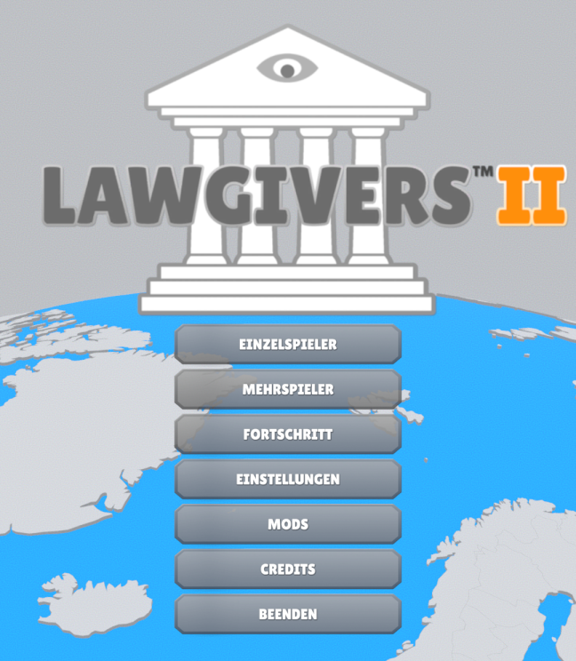

<div align="center">

# Mod Manager

**Turn your Lawgivers II mods on and off from inside the game.**




</div>

## Features

- **A MODS button in the main menu and the pause menu.** No config files, no renaming DLLs by hand.
- **Every mod is listed.** That includes mods that know nothing about the Mod Manager, and mods that are switched off.
- **Requirements are handled for you.** Switching on a mod also switches on the mods and libraries it needs.
- **Nothing breaks by accident.** A mod that another mod needs is locked (greyed out) until nothing needs it anymore.
- **Switches without a restart** for mods that support it. Every other mod changes on the next start, and the window shows that in orange.
- **Looks like part of the game**, in the game's language. **Open folder** takes you straight to `BepInEx\plugins`.



## Install

1. Install [BepInEx 6 for IL2CPP games](https://builds.bepinex.dev/projects/bepinex_be) (x64, build 790 or newer). Start the game once so BepInEx can set itself up.
2. Download `ModManager.dll` and `ModLibrary.dll` (the [Mod Library](https://github.com/Mindus1/lawgivers2-mod-library)) from the [Releases](../../releases) page.
3. Put both in `Lawgivers II\BepInEx\plugins`.
4. Start the game. You'll find **MODS** under Settings.

## How it works

Switching a mod off renames `SomeMod.dll` to `SomeMod.dll.disabled`. BepInEx only loads `.dll` files, so the mod stays off until you switch it back on. Nothing is deleted.

| Kind of mod | When the switch takes effect |
|---|---|
| Registered with the Mod Manager | Right away |
| Any other BepInEx plugin | The next time you start the game |

### Requirements and libraries

Mods declare what they need with BepInEx's standard `[BepInDependency]` attribute. The Mod Manager reads it straight from each DLL:

- **Switching a mod on** switches on everything it needs first, and everything those need.
- **A needed mod is locked.** Its switch is greyed out, and its row says who needs it ("Needed by Cheat Menu"). Once every mod that needs it is off, you can switch it off.
- **Something missing?** A switched-on mod that needs a mod you don't have says so in orange.
- **Libraries** (mods that exist for other mods, marked `[ModLibrary]`) are tagged **LIBRARY** and listed below the regular mods.

The Mod Manager is always on, since it runs the window, and so is the Mod Library it's built on. To remove them, delete their DLLs.

<br clear="right">

## For mod authors

Your mod shows up in the list without any extra work. Three optional steps make it a better citizen.

### 1. Declare what you need

```csharp
[BepInPlugin("you.lawgivers2.mymod", "My Mod", "1.0.0")]
[BepInDependency(ModLibrary.Plugin.Guid)]       // Hard requirement: switched on together with your mod.
[BepInDependency("someone.otherlib")]           // Any other mod or library works the same way.
[ModDescription("One sentence about what My Mod does.")]
public class Plugin : BasePlugin { ... }
```

Soft dependencies (`DependencyFlags.SoftDependency`) aren't requirements, so they're not switched on or locked.

`[ModDescription]` and `[ModLibrary]` come from the [Mod Library](https://github.com/Mindus1/lawgivers2-mod-library). They're read from the DLL, so they show even while your mod is off.

### 2. Switch without a restart

Reference `ModManager.dll` (with `Private="false"`) and register in `Load()`:

```csharp
[BepInDependency(ModManager.Plugin.Guid)]
public class Plugin : BasePlugin
{
    public override void Load()
    {
        Mods.Register(this, enabled =>
        {
            // enabled == false: undo what your mod changed in the running game (hide your UI, stop your effects).
            // enabled == true:  bring it back.
        });
    }
}
```

Your mod is always on when `Load()` runs: a mod that is switched off isn't loaded at all. Your Harmony patches stay installed while the player has the mod off, so check your own flag in them.

### 3. Build your UI from the same parts

The [Mod Library](https://github.com/Mindus1/lawgivers2-mod-library) has the menu buttons, HUD buttons, panels and switch rows the Mods window and the Cheat Menu are built from.

### API

| Member | What it does |
|---|---|
| `Plugin.Guid` | The Mod Manager's GUID, for `[BepInDependency]`. |
| `Mods.Register(plugin, onToggle)` | Lets the player switch your mod without a restart. `onToggle(bool)` runs when they flip its switch. |

## Build from source

You need the .NET SDK (6 or newer) and the game with BepInEx installed. Build and install the [Mod Library](https://github.com/Mindus1/lawgivers2-mod-library) first: this project references the installed `ModLibrary.dll`.

```bash
dotnet build -c Release -p:GameDir="D:\Games\Steam\steamapps\common\Lawgivers II"
```

That copies `ModManager.dll` into `BepInEx\plugins`. Close the game first, or the copy fails because the DLL is in use.

## Troubleshooting

- **No MODS button:** check that `ModLibrary.dll` is installed, then look in `BepInEx\LogOutput.log` for lines from `Mod Manager` or `Mod Library`.
- **A mod is still running after you switched it off:** it isn't registered, so the change happens when you restart the game. Its row says so in orange.
- **A switch is greyed out:** another switched-on mod needs that one. Its row says which. Switch that mod off first.
- **A mod you switched off disappeared from the folder:** it's still there, as `.dll.disabled`.
